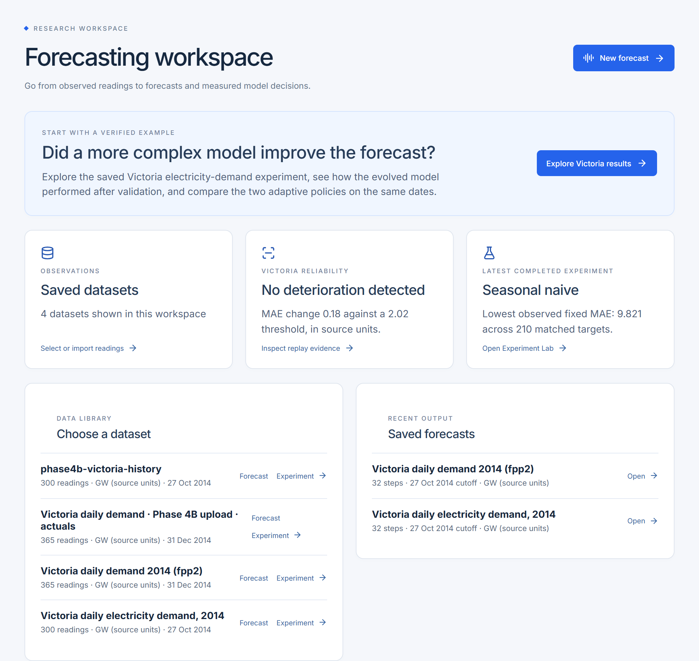
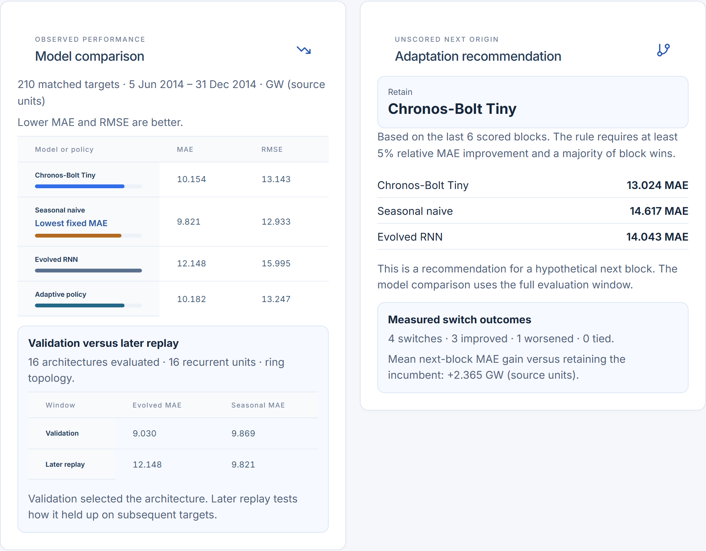
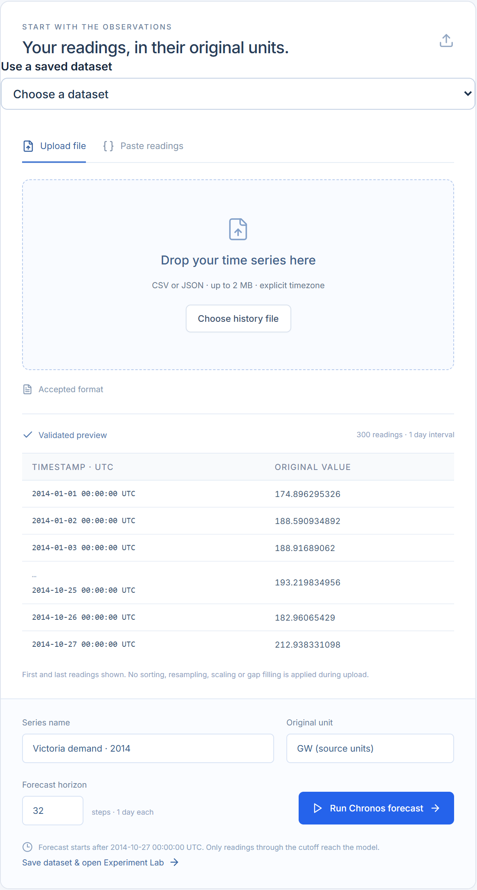
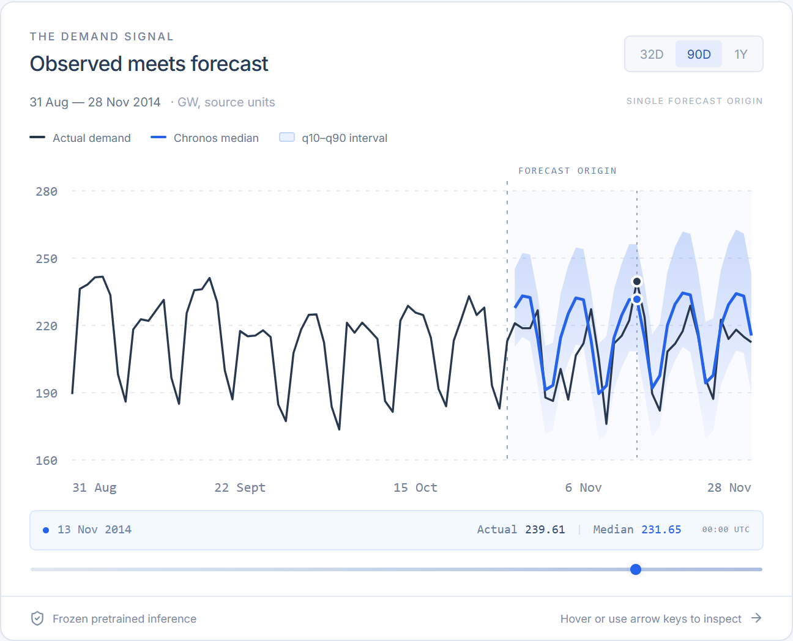
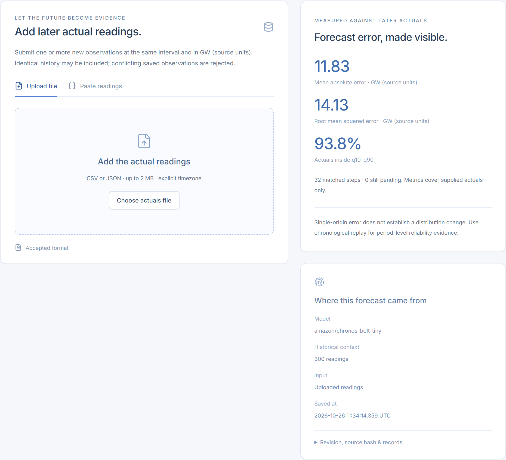
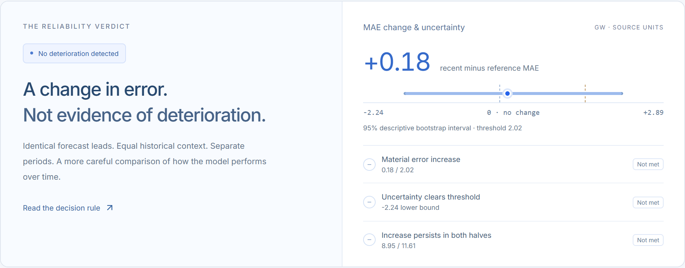
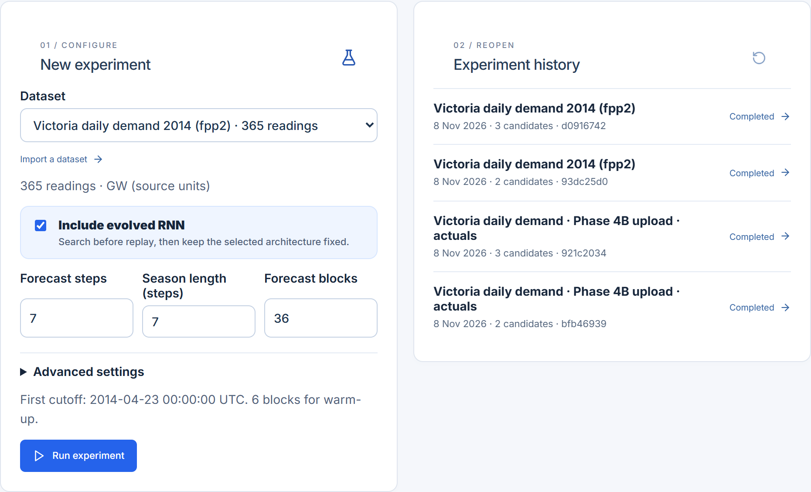
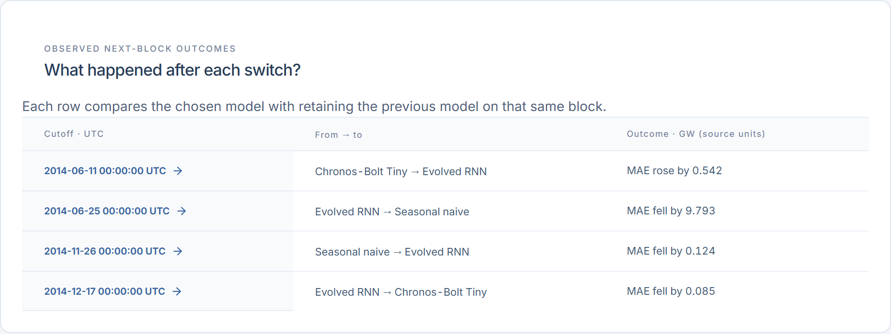
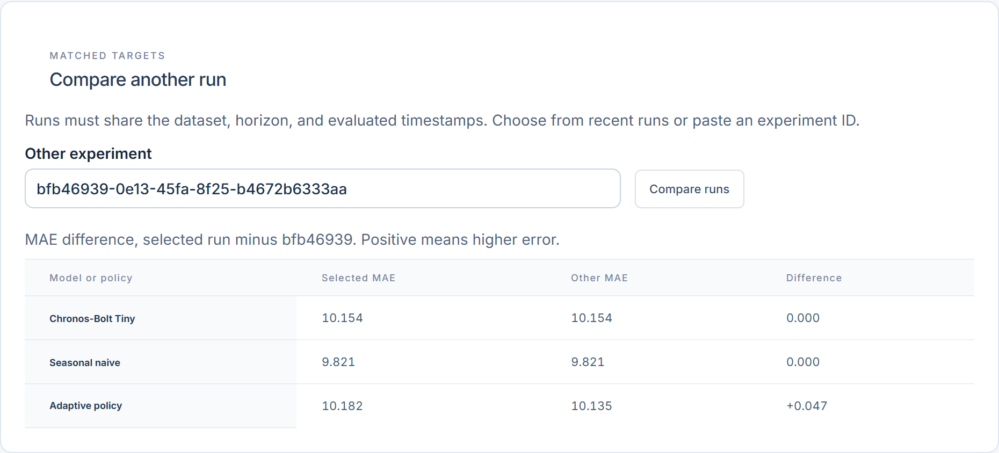

# AdaptSense AI

AdaptSense AI is a forecasting and evaluation workspace for time-series data. Upload observations, run a pretrained forecast, and test whether switching forecasting methods improves predictions as new data arrives. The included demo uses real electricity demand from Victoria, Australia.

## What you can do

- **Forecast from your data.** Upload or paste CSV or JSON readings, validate timestamps and units, choose a cutoff and horizon, and run Chronos-Bolt Tiny on CPU. Inspect its median and q10–q90 estimates and evaluate against later actuals.
- **Replay historical performance.** Issue forecasts in chronological order and compare identical forecast leads across periods. Inspect changes in MAE, a seasonal-naive comparison, and a descriptive bootstrap interval.
- **Run adaptive experiments.** Compare Chronos, seasonal naive, and an optional evolved recurrent model on matched targets. Follow background progress, reopen SQLite-backed results, and compare compatible runs.
- **Inspect model decisions.** See which model the policy chose before each block, how switches performed on later actuals, and which model the policy recommends for a hypothetical next block.

## Victoria experiment

This comparison uses 210 daily targets after warm-up, in the dataset's source units. Lower error is better.

| Model or policy | MAE | RMSE |
| --- | ---: | ---: |
| Weekly seasonal naive | **9.821** | **12.933** |
| Chronos-Bolt Tiny | 10.154 | 13.143 |
| Evolved RNN | 12.148 | 15.995 |
| Adaptive policy with two candidates | 10.135 | 13.128 |
| Adaptive policy with three candidates | 10.182 | 13.247 |

The evolved RNN scored 9.030 MAE during architecture validation versus 9.869 for seasonal naive. On later replay, seasonal naive had the lowest error. Including the evolved candidate raised adaptive MAE by 0.047 on the same targets. The results describe this historical window and one evolution seed. The next-block recommendation is unscored. [Evolution report](EVOLUTIONARY_FORECASTING_REPORT.md) · [Phase 6 verification](PHASE6_REPORT.md)

## Walkthrough

### Import, forecast, and evaluate

### Inspect reliability

### Run and compare experiments

## Run locally

Requires Python 3.13 and Node.js 22. From the project root in PowerShell:

~~~powershell
python -m venv .venv
.\.venv\Scripts\python -m pip install -r requirements.txt
npm ci --prefix frontend
npm run build --prefix frontend
.\.venv\Scripts\python -m scripts.seed_demo
.\.venv\Scripts\python -m uvicorn app.main:app --host 127.0.0.1 --port 8765
~~~

Open [the workspace](http://127.0.0.1:8765/) and choose **Explore Victoria results**. The seeded results can be browsed without model inference. The first live forecast fetches the pinned Chronos checkpoint if it is missing. Set `HF_HUB_OFFLINE=1` before starting the server to require a preloaded cache.

For frontend development, run `npm run dev --prefix frontend` with FastAPI running, then open [Vite](http://127.0.0.1:5174/). The [deployment guide](DEPLOYMENT.md) covers Docker, persistent SQLite and model storage, readiness, and access control. The local production build was verified. The Docker image still needs a build and smoke test on a container host.

## Architecture and tools

| Layer | Tools and responsibilities |
| --- | --- |
| Frontend | React, TypeScript, Vite, and SVG charts for forecasts, replay, comparisons, and experiment progress |
| API | Python, FastAPI, Pydantic, and Uvicorn for ingest, validation, inference, and background experiment tracking |
| Forecasting | Amazon Chronos-Bolt Tiny with PyTorch, a seasonal-naive baseline, and an independently implemented NumPy recurrent reservoir search |
| Persistence | SQLite for datasets, immutable forecasts, replay evidence, and experiment history |
| Verification | pytest and Vitest. The final local run passed 54 backend and 23 frontend tests |
| Deployment | Docker configuration for a single CPU instance, with a persistent volume and a SQLite readiness endpoint |

The replay stores forecasts and the policy choice before revealing the actuals for each block. The RNN search fits candidates and chooses the winner on pre-replay data. Its architecture stays fixed during replay. The optional evidence investigation API is separate from the main workflows and disabled by default in the Docker configuration.

| Workflow | API |
| --- | --- |
| Dataset import and catalog | `POST /series`, `POST /series/csv`, `GET /series` |
| Forecast and evaluation | `POST /forecasts`, `POST /forecasts/{id}/evaluate` |
| Reliability | `POST /replays`, `GET /replays/{id}` |
| Background experiments | `POST /adaptive-experiments?background=true`, `GET /adaptive-experiments/{id}/status` |
| History and comparison | `GET /adaptive-experiments`, `GET /adaptive-experiments/{id}/comparison?against={other_id}` |
| Demo and readiness | `GET /demo`, `GET /health/ready` |

[Interactive API documentation](http://127.0.0.1:8765/docs) · [Backend integration report](BACKEND_INTEGRATION_REPORT.md)

~~~powershell
.\.venv\Scripts\python -m pytest -q
npm test --prefix frontend
~~~

## Data and research

The demo uses the 2014 Victoria daily electricity demand series from `fpp2::elecdaily`, credited to the Australian Energy Market Operator and the Australian Bureau of Meteorology. Dates are indexed in UTC and demand values retain the dataset's source units. The recurrent search is an independent implementation inspired by research on evolutionary forecasting and nonstationary time series. [Dataset documentation](https://vincentarelbundock.github.io/Rdatasets/doc/fpp2/elecdaily.html) · [Chronos-Bolt Tiny](https://huggingface.co/amazon/chronos-bolt-tiny) · [EXAMM-Extended](https://github.com/zimenglyu/EXAMM-Extended) · [ONE-NAS paper](https://arxiv.org/abs/2302.10347)

## About me

**Abdullah Siddique** is an AI engineer who builds applied AI and full-stack tools. [Website](https://abdullahsiddique.co.uk) · [LinkedIn](https://www.linkedin.com/in/mr-abdullah-siddique) · [GitHub](https://github.com/abdullah90907)
